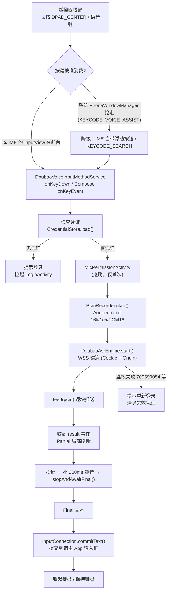
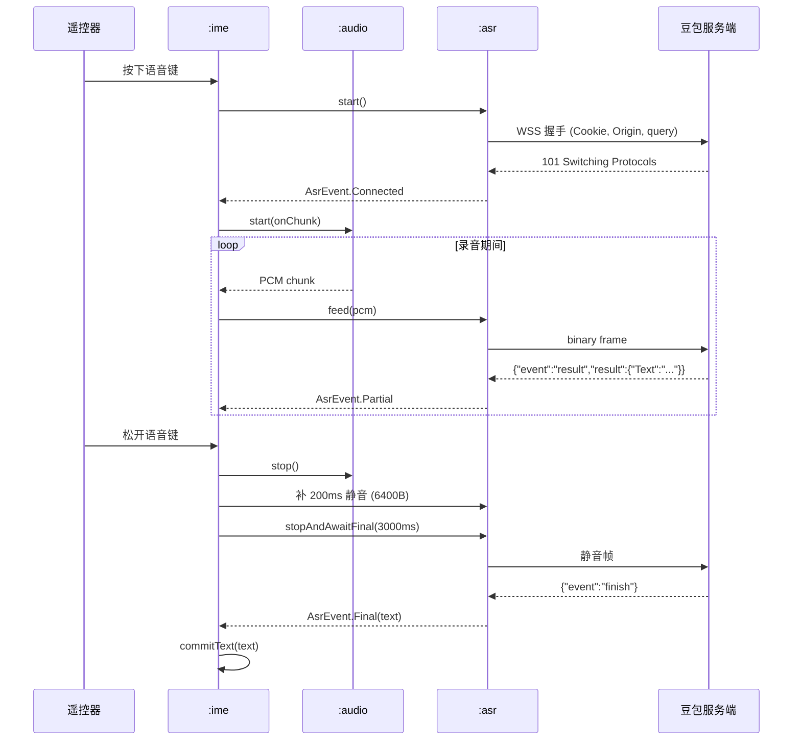

# 架构设计：Android TV 语音输入法

> 本文说明"为什么是这套技术栈"，以及模块怎么切、数据怎么流。
> 交互细节见 [tv-adaptation.md](tv-adaptation.md)，交付链路见 [ci-cd.md](ci-cd.md)。

## 目录

- [1. 一句话结论](#1-一句话结论)
- [2. 技术选型对比](#2-技术选型对比)
- [3. 模块职责](#3-模块职责)
- [4. 数据流](#4-数据流)
- [5. 关键取舍](#5-关键取舍)
- [6. 目录结构](#6-目录结构)

## 1. 一句话结论

**原生 Kotlin + Compose for TV（`androidx.tv:tv-material`）+ `InputMethodService`，单 APK 交付。**

这不是"原生更正统"的审美选择，而是被三件事逼出来的：

1. **输入法必须返回原生 `View` 树。** `InputMethodService.onCreateInputView()` 要返回 `android.view.View`，
   系统输入法框架不认 Flutter/RN 的画布。
2. **语音链路要低延迟、要能直接摸 `AudioRecord` 和 WebSocket。** 上游 macOS/Windows/Linux 三端已经
   把豆包 WSS 协议跑通并写了规格文档，Android 端只要照着实现，不引入跨端桥接层。
3. **遥控器焦点模型是 Android TV 特有的。** `FocusRequester` / `focusRestorer` / leanback 焦点环路
   在跨端框架里要么没有、要么要自己写一套，成本高于直接写 Compose。

## 2. 技术选型对比

| 维度 | 原生 Kotlin + Compose TV ✅ | Flutter | React Native | KMP（共享逻辑） |
|---|---|---|---|---|
| IME 可行性 | 原生 `InputMethodService`，`onCreateInputView` 返回 Compose `View` | **不可行**：无官方 IME 支持，需自绘 InputView 并桥接 platform view，几乎等于重写 | **不可行**：同上，且 RN 的 View 树挂在 ReactRootView 下，无法作为输入法视图返回 | 逻辑可共享，但 IME 的 View 层仍要各平台原生写 |
| 语音链路 | `AudioRecord` + OkHttp WebSocket，直连豆包 WSS | 需 platform channel 转一层，PCM 分片跨桥有拷贝开销 | 同 Flutter，且 JSI 之外的回调有延迟 | `:asr` 可用 KMP 共享（本项目就是按这个思路做的，只是先只落地 JVM 端） |
| 包体积 | 基线约 3–5 MB（Compose + TV Material） | +8–12 MB（引擎） | +6–10 MB（Hermes + 原生依赖） | 与原生基本持平 |
| TV 焦点生态 | `androidx.tv`、`FocusRequester`、leanback 全部原生可用 | 焦点系统要自己实现，遥控器按键语义缺失 | 同 Flutter | 同原生 |
| 团队成本 | 需要懂 Android；但只需一套代码 | 需要同时懂 Flutter + Android 原生（IME 部分必须原生） | 同 Flutter | 最高（多平台心智负担） |
| 结论 | **采用** | 否决 | 否决 | 局部借鉴（`:asr` 保持纯 JVM，未来可搬 KMP） |

补充说明：

- **KMP 不是被否决，而是被"收缩"了。** `:asr` 是纯 `kotlin-jvm` 模块、零 Android 依赖，
  它的协议解析和失败分类天然可移植。将来要出 iOS/桌面端时，把 `:asr` 直接切成 KMP 模块即可，
  不需要动 `:ime` 和 `:ui`。
- **没有选 Compose for TV 的替代品 leanback（XML + `BrowseFragment`）。** leanback 库已进入维护状态，
  且和 Compose 混用时焦点行为更不可控；新代码统一用 Compose，只在必要时通过 `AndroidView` 内嵌。

## 3. 模块职责

| 模块 | Gradle 类型 | 命名空间 | 职责 | 是否可单测 |
|---|---|---|---|---|
| `:asr` | `kotlin-jvm` | `com.doubao.murmur.tv.asr` | 豆包 WSS 协议：URL 构建、Cookie 鉴权头、消息解析、失败分类、`AsrEngine` 抽象与 `DoubaoAsrEngine` 实现 | ✅ 纯 JVM，CI 上真跑 |
| `:audio` | `android-library` | `com.doubao.murmur.tv.audio` | `AudioRecord` 采集、48k→16k 重采样、能量 VAD、`MicProbe` 麦克风能力探测 | ✅ 重采样/VAD 可测 |
| `:auth` | `android-library` | `com.doubao.murmur.tv.auth` | WebView 登录取 Cookie + localStorage、`EncryptedSharedPreferences` 加密存储凭证 | ⚠️ 依赖 Android 框架，用 Robolectric |
| `:ui` | `android-library` | `com.doubao.murmur.tv.ui` | Compose TV 设计系统：主题、过扫描安全区、焦点放大组件、按键提示 | ✅ Compose UI 测试 |
| `:ime` | `android-library` | `com.doubao.murmur.tv.ime` | `DoubaoVoiceInputMethodService` + 遥控器键盘 UI + 文本提交；manifest 合并进 `:app` | ⚠️ 需仪器测试 |
| `:app` | `android-application` | `com.doubao.murmur.tv.app` | Leanback 启动器：`MainActivity`、`LoginActivity`、`MicPermissionActivity`、`DiagnosticsActivity`、`ImeSettingsActivity` | ⚠️ 需仪器测试 |
| `:benchmark` | `com.android.test` | — | Macrobenchmark：输入法弹出耗时、焦点移动帧率、录音启动延迟 | — |

依赖方向（单向，不允许反向）：

```
:app ──> :ime ──> :ui
 │        │        │
 │        └────> :asr <── :audio
 │        └────> :audio
 └────> :auth ──> :asr
```

`:ime` 不依赖 `:app`：输入法 Service 的生命周期完全由系统输入法框架驱动，
启动器只是"引导页 + 设置入口"，两者通过 `Intent` 与 `SharedPreferences` 解耦。

## 4. 数据流

### 4.1 一次完整输入



### 4.2 模块间时序（停止与终稿）



关键不变量：

- **补 200 ms 静音是硬要求**，6400 字节（16k × 1ch × 2B × 0.2s）。少了会丢最后一个字。
- **服务端静默 250 ms 后才认作终稿**，所以 `stopAndAwaitFinal` 的超时不能低于 3000 ms。
- **`Partial` 是全文覆盖式**，不是增量。UI 必须整段替换，不能 append。

## 5. 关键取舍

### 5.1 单 APK vs 双 APK（启动器 + 输入法）

| 方案 | 优点 | 缺点 | 结论 |
|---|---|---|---|
| **单 APK**（`:ime` 作为 library 并入 `:app`） | 一个 versionCode、一条分发链路、一次安装、登录态与输入法同进程共享 | 用户不启用输入法时也占着启动器图标；包体略大 | ✅ 采用 |
| 双 APK | 可只装输入法 | 两个 versionCode 要同步、两套签名、登录态要跨进程共享、Play 要维护两个条目 | 否决 |

单 APK 的代价可控：`BUILD_CHANNEL` + Leanback 入口只影响 `:app`，输入法 Service 的声明通过
manifest merge 并入，安装后不启用输入法就不会占用任何前台资源。

### 5.2 协议实现放在 `:asr` 而不是 `:ime`

`:asr` 是**纯 JVM** 模块，没有任何 `android.*` 依赖。好处：

- CI 上 `gradle :asr:test` 是真的跑单元测试，不需要模拟器，几十秒出结果；
- 协议 bug（URL 少一个 query 参数、失败码分类写错）能在 PR 阶段拦住，
  而不是等到真机上"识别不出字"再排查；
- 未来切 KMP 时零改动。

代价是 `:asr` 里的 WebSocket 客户端只能用 OkHttp（纯 JVM 可用），不能依赖 Android 的 `WebSocket` 封装——
但这本来就是更好的选择。

### 5.3 凭证存储用 `EncryptedSharedPreferences` 而不是明文

`Cookie` 里的 `sessionid` 是 httpOnly 的登录凭证，等价于账号密码。落地必须加密：

- `EncryptedCredentialStore` = `EncryptedSharedPreferences` + Android Keystore `MasterKey`；
- 卸载应用即失效，不写外部存储，不参与 `adb backup`（`android:allowBackup="false"`）。

### 5.4 不做"全局语音助手"

本项目的定位是**输入法**：只在输入框获得焦点、用户主动唤起键盘时才工作。
不做常驻监听、不做系统级语音助手，原因有二：

1. 常驻麦克风在 Play 政策里是高风险项，且 TV 端用户预期是"按一下说一句"；
2. `KEYCODE_VOICE_ASSIST` 被系统消费（见 [tv-adaptation.md](tv-adaptation.md#2-遥控器交互)），
   想做全局唤起就得走无障碍服务，那是另一个量级的合规成本。

## 6. 目录结构

```
android/
├── settings.gradle.kts            # 模块声明，rootProject.name = "doubao-murmur-tv"
├── build.gradle.kts               # 版本派生 + 插件版本统一管理
├── gradle.properties              # JVM 参数、AndroidX 开关
├── version.properties             # 版本默认值（真正的可信源是 git tag）
├── detekt.yml                     # 静态检查规则
├── gradle/
│   ├── libs.versions.toml         # 版本目录：AGP 8.7.3 / Kotlin 2.0.21 / compileSdk 35
│   └── wrapper/
│       └── gradle-wrapper.properties  # Gradle 8.9（jar 由 bootstrap-wrapper.sh 生成）
├── app/                           # application：Leanback 启动器与各类引导页
│   └── src/main/
├── ime/                           # InputMethodService 与遥控器键盘
│   └── src/main/
├── ui/                            # Compose TV 设计系统
│   └── src/main/
├── audio/                         # AudioRecord / 重采样 / VAD
│   └── src/main/
├── auth/                          # WebView 取凭证 + 加密存储
│   └── src/main/
├── asr/                           # 豆包 WSS 协议（纯 JVM，可单测）
│   └── src/
├── benchmark/                     # Macrobenchmark
└── docs/
    ├── architecture.md            # 本文
    ├── tv-adaptation.md           # TV 适配细节
    ├── ci-cd.md                   # 流水线与分发
    └── release-checklist.md       # 发版清单
```

仓库根另有：

```
scripts/android/                   # CI 脚本（版本计算、签名解码、产物校验、OTA manifest…）
.github/workflows/android-*.yml    # 五条 Android 工作流
.github/dependabot.yml             # 依赖更新（只覆盖 /android 与 Actions）
```

> 注意：`scripts/android/` 是 **Android 专用**脚本目录，与根目录原有的 macOS 打包脚本
> （`scripts/build.sh` 等）互不影响，两者不要混用。
