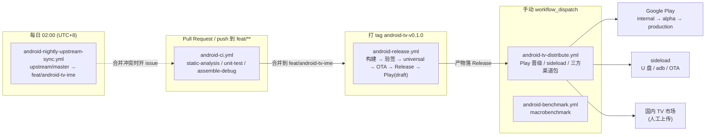

# CI/CD 与分发

> 覆盖：五条工作流各自的职责、版本与签名策略、产物矩阵、分发渠道矩阵、回滚与排障。
> 具体操作步骤见 [release-checklist.md](release-checklist.md)。

## 目录

- [1. 流水线全景](#1-流水线全景)
- [2. 工作流职责](#2-工作流职责)
- [3. 触发条件](#3-触发条件)
- [4. Secrets 与 Environments](#4-secrets-与-environments)
- [5. 版本策略](#5-版本策略)
- [6. 签名管理](#6-签名管理)
- [7. 产物矩阵](#7-产物矩阵)
- [8. 分发渠道矩阵](#8-分发渠道矩阵)
- [9. 回滚策略](#9-回滚策略)
- [10. 常见故障排查](#10-常见故障排查)

## 1. 流水线全景



## 2. 工作流职责

| 工作流 | 职责 | 关键约束 |
|---|---|---|
| `android-ci.yml` | PR 与开发分支的日常门禁：detekt / lint / 单测 / Debug 构建 | 三作业并行、不互相阻塞；`:asr:test` 是硬门禁 |
| `android-release.yml` | 正式发版：签名的 AAB + APK + universal APK + OTA manifest + GitHub Release + Play 上传 | 只由 `android-tv-v*` tag 或手动触发；签名走 secret |
| `android-tv-distribute.yml` | 已发布版本的分发：Play 轨道晋级 / sideload 包 / 三方渠道包 | 生产轨道需 `confirm_production` + Environment 审批 |
| `android-nightly-upstream-sync.yml` | 每日把上游 `master` 合并进开发分支 | 冲突只开 issue 不动分支；合并后跑回归，失败则回滚 |
| `android-benchmark.yml` | Macrobenchmark 编译 + （可选）FTL 真机基准确 | 无 FTL 凭证时跳过并写 summary，不 fail |

一句话概括依赖关系：**CI 管质量、Release 管产物、Distribute 管渠道、Benchmark 管性能、Sync 管上游。**

两个容易踩的实现细节：

- **SDK 由 `android-actions/setup-android@v3` 显式安装**（`platforms;android-35`、`build-tools;35.0.0`、
  `platform-tools`）。`gradle/actions/setup-gradle` 只装 Gradle，不装 Android SDK，
  而 runner 预装的 SDK 不保证带 API 35 的 build-tools。**build-tools 版本必须与 AGP 8.7.3 的默认值
  `35.0.0` 对齐**——版本对不上时 AGP 会尝试现场下载或回退，首次构建会明显变慢甚至失败。
  Release 作业还会把 `$ANDROID_HOME/build-tools/35.0.0` 加进 `PATH`，保证 `apksigner` / `aapt2` 可直接调用。
- **detekt 分硬软两档**：`:asr:detekt` 是硬门禁（`ignoreFailures=false`），失败即 job 红；
  `:app` 等模块是软门禁（`ignoreFailures=true`），只提示不阻断。CI 里拆成两个 step，
  避免 `:asr` 失败后 Gradle 停下、看不到其余模块的检查结果。
- **`:app:assembleRelease` 的签名门禁是硬失败**：`checkReleaseSigning` 在四个
  `ANDROID_KEYSTORE_*` / `ANDROID_KEY_*` 缺任一时直接 `throw GradleException`。
  因此：`android-release.yml` 必须配齐 secret（不加任何逃生参数）；
  `android-benchmark.yml` 在**没有 keystore secret** 时才追加 `-PallowUnsignedRelease=true`
  （产物未签名、不可安装，只用于证明 release 变体能编译）；CI 工作流完全不碰 release 变体。

## 3. 触发条件

| 工作流 | 触发 | 过滤条件 | 并发策略 |
|---|---|---|---|
| `android-ci.yml` | `pull_request`、`push`、`workflow_dispatch` | 分支 `feat/**`、`develop`、`master`；paths: `android/**`、`.github/workflows/android-*.yml`、`scripts/android/**` | 同 ref 取消进行中的旧任务 |
| `android-release.yml` | `push` tag `android-tv-v*`、`workflow_dispatch` | inputs: `version`(必填)、`track`(默认 internal)、`dry_run`(默认 false) | 不取消（发版不能被打断） |
| `android-tv-distribute.yml` | `workflow_dispatch` | inputs: `version`、`channel`、`release_notes`、`confirm_production` | 默认 |
| `android-nightly-upstream-sync.yml` | `schedule` `0 18 * * *`（UTC，= 北京 02:00）、`workflow_dispatch` | — | 串行，不取消 |
| `android-benchmark.yml` | `schedule` `0 3 * * 1`（UTC，= 北京周一 11:00）、`workflow_dispatch` | — | 默认 |

### 3.1 为什么 tag 前缀必须是 `android-tv-v*`

上游仓库的 `release.yml`（macOS）、`windows-release.yml`、`flatpak-release.yml` **全部以 `v*` 触发**。

如果用 `v1.0.0` 给 Android 发版：

- `release.yml` 会在 `macos-15` 上跑 XcodeBuild（约 15 分钟）；
- `windows-release.yml` 会跑 Tauri 双架构构建（约 20 分钟）；
- `flatpak-release.yml` 会跑 Flatpak 打包；
- 三个工作流都会往**同一个 Release** 里追加各自的产物（它们用同一个 `tag_name`）。

结果是一个"Android TV 版本"的 Release 里混着 `.dmg` / `.msi` / `.flatpak`，版本号也完全对不上。
用 `android-tv-v*` 前缀可以精确隔离。

## 4. Secrets 与 Environments

### 4.1 Secrets

| 名称 | 用途 | 配置位置 | 必需 |
|---|---|---|---|
| `ANDROID_KEYSTORE_BASE64` | 签名 keystore 的 **base64 文本**（不是文件路径） | repo Secrets | Release / 可选 Benchmark |
| `ANDROID_KEYSTORE_PASSWORD` | keystore 密码 | repo Secrets | 同上 |
| `ANDROID_KEY_ALIAS` | 密钥别名 | repo Secrets | 同上 |
| `ANDROID_KEY_PASSWORD` | 密钥密码 | repo Secrets | 同上 |
| `PLAY_SERVICE_ACCOUNT_JSON` | Play Developer API 服务账号 JSON **全文** | repo Secrets | Play 相关作业必需 |
| `GCP_SA_JSON` | Google Cloud 服务账号（Firebase Test Lab 用） | repo Secrets | 可选 |
| `FTL_PROJECT_ID` | Firebase 项目 ID | repo Secrets | 可选 |
| `AWS_ACCESS_KEY_ID` / `AWS_SECRET_ACCESS_KEY` / `AWS_DEFAULT_REGION` | 三方渠道包同步到对象存储 | repo Secrets | 可选 |
| `OSS_BUCKET` / `OSS_ACCESS_KEY_ID` | 目标 bucket 名与（兼容 S3 的）访问键 | repo Secrets | 可选 |

> `GITHUB_TOKEN` 由 Actions 自动注入，不需要手动配置；写权限通过 job 级 `permissions` 授予。

#### ⚠️ secret 名 vs 构建期环境变量名：两套名字，别搞混

这是配置时最容易错的地方：

| 阶段 | 变量名 | 形态 |
|---|---|---|
| GitHub Secret（仓库里配置的） | `ANDROID_KEYSTORE_BASE64` | **一段 base64 字符串** |
| 构建期环境变量（Gradle 读的） | `ANDROID_KEYSTORE_PATH` | **磁盘上 keystore 文件的绝对路径** |

两者由 `scripts/android/decode-keystore.sh` 桥接：

```
secret ANDROID_KEYSTORE_BASE64
        │  base64 -d
        ▼
$RUNNER_TEMP/release.keystore            ← 真实文件
        │  chmod 600 + keytool 试读
        ▼
GITHUB_ENV: ANDROID_KEYSTORE_PATH=...    ← 构建期变量
        │
        ▼
:app 的 signingConfigs 读 ANDROID_KEYSTORE_PATH
```

所以：

- **仓库 Secrets 里不要建 `ANDROID_KEYSTORE_PATH`**，建了也不会被读取；
- `ANDROID_KEYSTORE_PASSWORD` / `ANDROID_KEY_ALIAS` / `ANDROID_KEY_PASSWORD` 三个名字 secret 与构建期同名，直接透传，不需要改名；
- 本地构建时反过来：直接 `export ANDROID_KEYSTORE_PATH=/path/to/release.keystore`，不需要 base64。

### 4.2 Variables（非敏感）

| 名称 | 用途 | 默认 |
|---|---|---|
| `BUNDLETOOL_SHA256` | 钉死 bundletool jar 的 sha256 | 未配置时只告警并打印实际值 |
| `TV_DEVICE_MODEL` | FTL 上跑 benchmark 的机型 | `sabrina`（Chromecast with Google TV） |
| `TV_DEVICE_VERSION` | 对应 API level | `30` |

### 4.3 Environments

| Environment | 绑定工作流 | 建议保护规则 |
|---|---|---|
| `play-internal` | release、distribute | 无需审批（内部测试） |
| `play-alpha` | release、distribute | 1 名 reviewer |
| `play-beta` | release | 1 名 reviewer |
| `play-production` | release、distribute | **2 名 reviewer + 禁止自审** |

在仓库 Settings → Environments 里创建后，`environment: play-${{ inputs.track || 'internal' }}` 会自动匹配。
生产环境建议再加一条 "Deployment branches: selected branches"，只允许 `android-tv-v*` tag 部署。

两个工作流的写法略有不同，但落到同名 Environment：

| 工作流 | 写法 | 实际解析结果 |
|---|---|---|
| `android-release.yml` | `environment: play-${{ inputs.track \|\| 'internal' }}` | `play-internal` / `play-alpha` / `play-beta` / `play-production` |
| `android-tv-distribute.yml`（Play 晋级） | `environment: ${{ inputs.channel }}` | `play-internal` / `play-alpha`（取值来自 choice） |
| `android-tv-distribute.yml`（生产放量） | `environment: play-production` | `play-production` |

## 5. 版本策略

### 5.1 单一可信源是 git tag

```
git tag android-tv-v0.1.0   ← 真正的版本定义在这里
        │
        ├─→ compute-version.sh 派生 versionName + versionCode
        ├─→ gradle -PversionName=... -PversionCode=... 注入构建
        └─→ AndroidManifest / BuildConfig / AAB / OTA manifest 全部一致
```

`android/version.properties` **只是本地开发的默认值**，CI 不读它做决策。
原因：如果让一个文件当版本源，就会出现"tag 是 0.2.0，但文件里还是 0.1.0"的漂移，
而 Play 只认 versionCode，漂移一次就是一次事故。

### 5.2 versionCode 公式

```
versionCode = major * 10000 + minor * 100 + patch
```

| versionName | versionCode |
|---|---|
| 0.1.0 | 100 |
| 0.1.1 | 101 |
| 0.2.0 | 200 |
| 1.2.3 | 10203 |
| 10.0.0 | 100000 |

约束（`compute-version.sh` 会强制校验）：

- `major < 1000`、`minor < 100`、`patch < 100` —— 否则三段十进制位会互相重叠；
- 发版前会扫描所有历史 `android-tv-v*` tag，若 versionCode 已被占用则**直接失败**并给出冲突 tag 名。

上限是 `999.99.99 → 9999999`，够用到天荒地老。

### 5.3 预发布版本

```
versionName = 1.2.3-beta.1
versionCode = (1*10000 + 2*100 + 3) * 10 + 1 = 102031
```

规则：**预发布 versionCode = 基础版本编码 × 10 + 预发布序号**（序号 ≤ 9）。

⚠️ **Play 渠道禁止使用预发布 versionCode**，两个原因：

1. Play Console 不接受带 `-` 的 versionName；
2. `102031 > 10203`，也就是说 `1.2.3-beta.1` 的 versionCode 比正式版 `1.2.3` 还大。
   一旦预发布包进了 Play，正式版 `1.2.3` 就再也传不上去了，只能发 `1.2.4`。

所以：**预发布只用于 GitHub Release / sideload / 三方渠道试水。** 要进 Play 必须是纯 `x.y.z`。

### 5.4 版本推进流程

```
nightly sync 合并上游
    ↓
开发提交（feat: / fix: / BREAKING CHANGE）
    ↓
bash scripts/android/bump-version-pr.sh     # 计算下一版 + 改 version.properties + 写 CHANGELOG
    ↓
开 PR → CI 通过 → 合并
    ↓
git tag android-tv-v0.2.0 && git push origin android-tv-v0.2.0
    ↓
android-release.yml 自动跑
```

语义化升级判定（`compute-version.sh --next`）：

| 提交特征 | 升级 |
|---|---|
| `BREAKING CHANGE:` / `type!:` | major |
| `feat:` | minor |
| 其它（`fix:` / `chore:` / 无前缀） | patch |

### 5.5 为什么不用 release-please / semantic-release

- release-please 的「文件更新器」只支持 `package.json` / `pom.xml` / `build.gradle` 等，
  **不支持 `.properties`**。强行接会把 `version.properties` 写成 JSON 或直接改坏。
- semantic-release 需要 npm 生态 + 一堆插件，为了改一个版本号引入 300 个依赖不划算。
- 本项目的版本号来源是 tag，CI 派生即可；`bump-version-pr.sh` 只有 30 行 shell，
  可读、可审计、出问题用 `bash -x` 就能查。

## 6. 签名管理

### 6.1 生成 keystore（只做一次）

```bash
keytool -genkeypair \
  -keystore release.keystore \
  -alias doubao-tv \
  -keyalg RSA \
  -keysize 4096 \
  -validity 10000 \
  -storetype PKCS12 \
  -dname "CN=Doubao Murmur TV, OU=Android, O=Murmur, L=Shenzhen, ST=Guangdong, C=CN"
```

要点：

- `-validity 10000`（约 27 年）：Play 要求密钥有效期覆盖应用生命周期，25 年以上是安全值。
- `-storetype PKCS12`：JKS 已废弃，PKCS12 是当前默认与推荐格式。
- **同一个包名 `com.doubao.murmur.tv` 终身只能用一个签名密钥**。换 key = 用户必须卸载重装 =
  存量用户全部丢失。这不是夸张，是 Play 的硬规则。

### 6.2 转成 secret

```bash
# Linux
base64 -w 0 release.keystore > keystore.b64
# macOS
base64 -i release.keystore | tr -d '\n' > keystore.b64
```

把 `keystore.b64` 的内容贴进 `ANDROID_KEYSTORE_BASE64`，然后**立刻删除本地明文文件**。

`decode-keystore.sh` 会：

1. 解码到 `$RUNNER_TEMP/release.keystore`（不是仓库目录）；
2. `chmod 600`；
3. `keytool -list` 试读，密码错 / 文件坏时给出中文错误并退出；
4. **全程不 echo 密码**，keytool 输出丢弃。

Release 工作流的最后一步是 `if: always()` 的删除，即使中途失败也会清理。

### 6.3 轮换与备份

| 场景 | 做法 |
|---|---|
| 日常备份 | keystore + 密码 + alias 存进**两个**离线介质（密码管理器 + 加密 U 盘），任何情况下不进 Git |
| 怀疑泄漏 | 立刻在 Play Console 申请 **upload key reset**（Play App Signing 托管了真实签名密钥时可行）；自签分发渠道的包无法轮换，只能通知用户重装 |
| 更换 CI | 只需重新配置 4 个 secret，keystore 本身不变 |
| 团队交接 | 交接 keystore 与密码时必须通过密钥管理系统，不允许通过 IM / 邮件发送 |

**绝对不要做的事**：把 `release.keystore`、`.jks`、`.keystore`、`keystore.b64` 提交到仓库，
哪怕是私有仓库、哪怕之后删掉（Git 历史里永远还在）。

### 6.4 验证签名一致性

```bash
# 本地 / CI 都能跑
apksigner verify --print-certs app-release.apk | grep 'SHA-256'
```

指纹应与上一次发布一致。Release 工作流会把指纹写进 Step Summary，
发布前**必须**肉眼比对一次（尤其是换过机器或重新配置过 secret 之后）。

## 7. 产物矩阵

| 产物 | 生成方式 | 用途 | 进 Play |
|---|---|---|---|
| `doubao-murmur-tv-<ver>.aab` | `gradle :app:bundleRelease` | Play 上传（Play 只接受 AAB） | ✅ |
| `doubao-murmur-tv-<ver>.apk` | `gradle :app:assembleRelease` | 通用 release APK，三方市场/内测 | ❌ |
| `doubao-murmur-tv-<ver>-universal.apk` | `bundletool build-apks --mode=universal` | sideload（U 盘、adb、OTA 盒子） | ❌ |
| `SHA256SUMS.txt` | `sha256sum` | 下载完整性校验 | — |
| `tv-ota/manifest.json` | `make-ota-manifest.sh` | TV 盒子内置升级器读取 | — |
| `changelog.md` | `gen-changelog.sh` | Release 正文 | — |
| `fastlane-metadata/<locale>/changelogs/<versionCode>.txt` | 由 changelog 截断生成 | Play "本次更新" | — |

OTA manifest 结构：

```json
{
  "versionCode": 100,
  "versionName": "0.1.0",
  "minSdk": 23,
  "sha256": "…",
  "sizeBytes": 8123456,
  "apkUrl": "https://github.com/<owner>/<repo>/releases/download/android-tv-v0.1.0/doubao-murmur-tv-0.1.0-universal.apk",
  "releaseNotes": "首个内测版本",
  "publishedAt": "2026-11-06T12:00:00Z"
}
```

TV 端升级器逻辑：拉 manifest → 比较 `versionCode` > 本地 → 下载 `apkUrl` → 校验 `sha256` → 调 `PackageInstaller` 静默/半静默安装。

## 8. 分发渠道矩阵

| 渠道 | 自动化程度 | 怎么做 | 谁能更新 | 灰度能力 |
|---|---|---|---|---|
| Play internal testing | **全自动** | `android-release.yml` 上传或 `distribute` 选 `play-internal` | 内部测试账号 | 无（全量给测试组） |
| Play alpha / beta | **全自动** | `distribute` 选 `play-alpha` | 白名单用户 | 无 |
| Play production | **半自动**（需人工审批） | `distribute` 选 `play-production` + `confirm_production=true` + Environment 审批 | 全部用户 | 靠 Play Console 的 staged rollout（5%→20%→50%→100%） |
| sideload（U 盘 / adb / 盒子 OTA） | **半自动** | `distribute` 选 `sideload` 产出资产，再用 `adb-install-tv.sh` 批量装 | 自己/客户 IT | 手工控制装哪台 |
| 国内 TV 市场（当贝/沙发管家/小米/华为/应用宝） | **人工** | `distribute` 选 `third-party` 产出 zip，运营去各家后台上传 | 各家审核 | 各平台自己决定 |

**关于国内 TV 市场的实话：**

当贝、沙发管家、小米电视应用商店、华为应用市场、应用宝**多数不提供公开的上传 API**，
也没有对外开放的自动化提交入口。有的甚至连开发者后台都只对公对公签约的开发者开放。

所以 `android-tv-distribute.yml` 的 `third-party` 分支产出的是**"人工上传用的成品包"**：

```
dist/third-party/
├── dangbei/
│   ├── doubao-murmurtv-0.1.0-dangbei.apk
│   ├── listing.md          # 应用名/简介/更新说明/权限说明/隐私政策占位
│   └── screenshots/README.md
├── sofa/ …
├── xiaomi/ …
├── huawei/ …
├── yingyongbao/ …
└── dangbei-doubao-murmurtv-0.1.0.zip   # 整体打包，运营直接下载上传
```

**这不是自动上架。** 任何声称"自动上架国内 TV 市场"的方案，要么是接了灰色渠道，要么是在骗你。

## 9. 回滚策略

四个渠道，四种回滚方式，难度依次递增。

| 渠道 | 回滚手段 | 限制 |
|---|---|---|
| Play（已开始放量） | Play Console → Release → **Halt rollout**，然后重新提交上一版 AAB | Play 拒绝 versionCode 回退，所以「回滚」实际是"发一个更大的 versionCode 的旧功能版本" |
| Play（还是 draft） | 直接丢弃 draft | 无成本，这也是默认 `releaseStatus: draft` 的原因 |
| sideload | `adb install -r -d` 降级安装旧 APK | 仅 sideload 可行；`-d` 只对 debug 签名/允许降级的包有效，必要时先 `adb uninstall` |
| 自建 OTA | 把 `manifest.json` 回指旧版本的 `apkUrl` + `versionCode` | 盒子的升级器必须支持"发现目标版本更低时也执行覆盖安装"，否则只会一直提示"已是最新" |

**versionCode 是单调递增的，这是 Play 的硬约束。** 所谓"回滚"在 Play 上永远是"往前发一个修复版"。
所以：

- 生产放量一定要从 5% 起，给"发修复版"留出时间窗口；
- 每个版本的 `changelog.md` 与 tag 必须保留，回滚时要能快速定位上一版。

## 10. 常见故障排查

### 10.1 签名不匹配

```
INSTALL_FAILED_UPDATE_INCOMPATIBLE: Package com.doubao.murmur.tv signatures do not match
```

| 原因 | 排查 | 解决 |
|---|---|---|
| CI 用了另一个 keystore | 比对 Step Summary 里的证书 SHA-256 | 恢复正确 secret |
| 本地调试包与 release 包混装 | `applicationIdSuffix = ".debug"` 会让 debug 包是 `com.doubao.murmur.tv.debug`，理论上不会撞 | 卸载旧包 |
| Play App Signing 已托管 | Play 上看到的是 Google 的重签名，本地看到的是 upload key，**两者本来就不同** | 属正常，比对 upload key 指纹而不是最终 APK |

### 10.2 versionCode 已存在

```
APK or Android App Bundle has already been used.
```

| 原因 | 解决 |
|---|---|
| tag 打重了（同一个 tag 被重新推送） | 换 patch 版本号重新打 tag；不要 force push tag |
| 预发布版先占了号 | 见 [5.3](#53-预发布版本)：Play 只能收正式版号 |
| 手工上传过一次 | 在 Play Console 查已用过的 versionCode，跳到下一个 |

`android-release.yml` 会在构建前扫描所有 `android-tv-v*` tag 做冲突检查，
但**它查不到你在 Play Console 手工传过的包**——这个只能靠人。

### 10.3 Play 因 TV 资格被拒

| 报错关键词 | 原因 | 解决 |
|---|---|---|
| "Your app is not available on TV devices" | 缺 `LEANBACK_LAUNCHER` 或 `android.software.leanback` | 补 manifest，重新出包 |
| "Missing TV banner" | 没有 320×180 banner | 补 `res/drawable-xhdpi/tv_banner.png` |
| "App does not support landscape" | 竖屏布局 | 锁定 landscape |
| "IME must not collect user data" | 隐私政策缺失或有输入内容上报 | 见 [tv-adaptation.md §8](tv-adaptation.md#8-上架红线) |
| "First upload must be done manually" | **Play 首次上传必须人工**，API 不支持创建全新应用 | 先在 Play Console 手工创建应用并传一次 AAB，之后 API 才能接管 |

### 10.4 构建类

| 现象 | 原因 | 解决 |
|---|---|---|
| `gradle: command not found` | 没装 `gradle/actions/setup-gradle`，或没指定 `gradle-version` | 检查工作流里是否有该 step |
| `Failed to find target with hash string 'android-35'` | 缺 Android SDK / build-tools：`setup-gradle` 只装 Gradle | 确认有 `android-actions/setup-android@v3` 且 `packages` 含 `platforms;android-35` 与 `build-tools;35.0.0` |
| `apksigner: command not found` | `build-tools/<ver>` 不在 PATH | Release 作业里有一步把 `$ANDROID_HOME/build-tools/35.0.0` 写进 `$GITHUB_PATH` |
| `checkReleaseSigning` 报缺 4 个变量 | 构建 release 变体但没配签名 secret | 正式发版必须配齐 4 个 secret；仅编译校验时加 `-PallowUnsignedRelease=true`（产物未签名、不可安装） |
| `Could not find gradle-wrapper.jar` | 有人改用了 `./gradlew` | 本仓库没有 wrapper jar，CI 一律用 `gradle`；本地需要先跑 `bootstrap-wrapper.sh` |
| `Unsupported class file major version` | JDK 版本不对（AGP 8.7 需要 JDK 17） | 检查 `setup-java` 的 `java-version` |
| `detekt` 任务不存在 | 新模块没应用 detekt 插件 | 在模块 `build.gradle.kts` 里 `alias(libs.plugins.detekt)` |
| `Entry name 'universal.apk' not found` | bundletool 模式不是 `--mode=universal` | 检查参数 |

### 10.5 上游同步类

| 现象 | 原因 | 解决 |
|---|---|---|
| 每天开一个冲突 issue | 根 README / `.gitignore` 持续冲突 | 手工解决一次并在两边保持一致的追加方式 |
| 同步后 CI 红 | 上游改了共享文件，Android 构建受影响 | 工作流已自动回滚并 `::error::` 提示，按 issue 处理 |
| 推送被拒 | 分支保护 | 给 `github-actions[bot]` 开 bypass，或用 PR 方式 |
